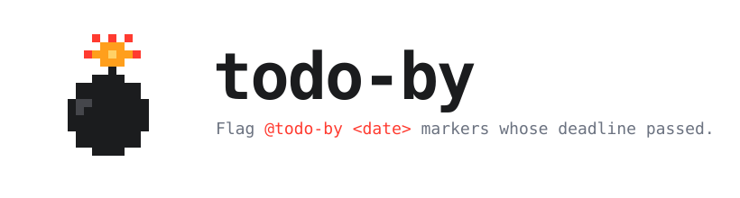

<p align="center">
  
</p>

<p align="center">
  <a href="https://github.com/alies-dev/todo-by/actions/workflows/ci.yml"></a>
  <a href="https://crates.io/crates/todo-by-cli"></a>
  <a href="LICENSE"></a>
</p>

**Fail CI when a TODO comes due.**

Write a TODO with a trigger. `todo-by` stays quiet until the trigger fires, then fails the build. Works in any language and any comment style.

| When | Write |
|---|---|
| A feature flag rollout ends on Dec 1 | `// @todo-by 2026-12-01 delete the new_checkout flag` |
| A runtime reaches end of life in October | `# @todo-by 2026-10 drop the Python 3.10 compat shim` |
| A deprecated API goes away in the next major | `// @todo-by v3.0 remove the deprecated getUser()` |
| Code must survive 2.0 and go right after it | `// @todo-by >v2.0 remove the 1.x config migration` |
| A test is skipped until your bug is fixed | `// @todo-by #482 re-enable the flaky upload test` |
| You work around a bug in a dependency | `// @todo-by https://github.com/acme/http/issues/45 remove the retry workaround` |

Once a trigger fires:

```console
$ todo-by --online
./src/checkout.ts:14: overdue since 2026-12-01: delete the new_checkout flag
./src/users.ts:3: version 3.0 reached (v3.0): remove the deprecated getUser()
./tests/upload.test.ts:8: #482 is closed (https://github.com/acme/app/issues/482): re-enable the flaky upload test
3 findings
```

Use it for small, mechanical chores (delete, revert, re-enable) that wait on a date, a release, or an issue. Work that needs an owner or a discussion belongs in your issue tracker.

## Install

```console
brew tap alies-dev/todo-by https://github.com/alies-dev/todo-by
brew install alies-dev/todo-by/todo-by
```

Or `cargo install todo-by-cli --locked`, or a prebuilt binary from [Releases](https://github.com/alies-dev/todo-by/releases). Details in [docs/install.md](https://github.com/alies-dev/todo-by/blob/main/docs/install.md).

## Run

```console
todo-by              # scan the current directory, exit 1 if anything is due
todo-by --warn 14    # also warn about dates due within 14 days
todo-by --online     # also check issue triggers against GitHub
```

In CI, run the same command; it prints GitHub annotations inside Actions. A ready workflow is in [docs/ci.md](https://github.com/alies-dev/todo-by/blob/main/docs/ci.md).

## Docs

- [Date triggers](https://github.com/alies-dev/todo-by/blob/main/docs/dates.md): accepted formats and early warnings
- [Version triggers](https://github.com/alies-dev/todo-by/blob/main/docs/versions.md): constraints and where the current version comes from
- [Issue triggers](https://github.com/alies-dev/todo-by/blob/main/docs/issues.md): tokens, private repositories, failures
- [Usage](https://github.com/alies-dev/todo-by/blob/main/docs/usage.md): every flag, output formats, exit codes
- [Configuration](https://github.com/alies-dev/todo-by/blob/main/docs/configuration.md): `todo-by.toml` and environment variables
- [What gets scanned](https://github.com/alies-dev/todo-by/blob/main/docs/scanning.md): ignore rules, dotfiles, binaries
- [CI](https://github.com/alies-dev/todo-by/blob/main/docs/ci.md): GitHub Actions workflow and phasing it in
- [Install](https://github.com/alies-dev/todo-by/blob/main/docs/install.md): Homebrew, Cargo, binaries, minimum Rust version

## Prior art

Inspired by [phpstan/phpstan-todo-by](https://github.com/staabm/phpstan-todo-by) by Markus Staab.

## License

MIT.
